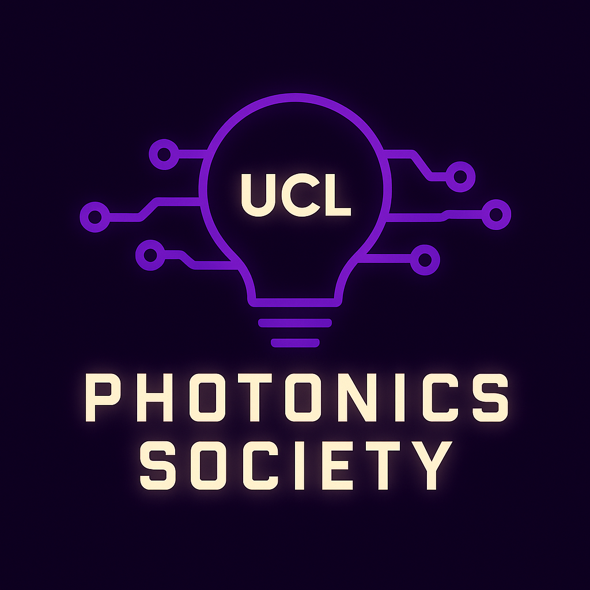
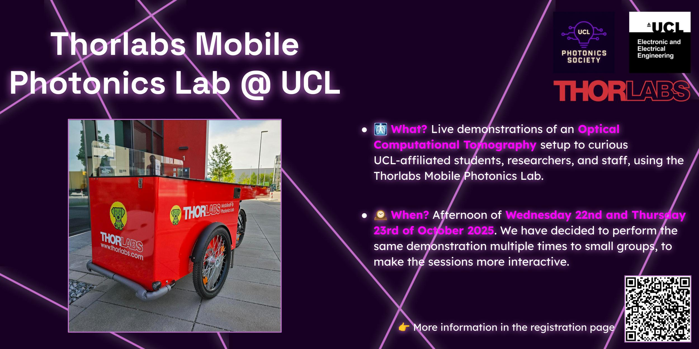

::: {.hero style="background-image: url('_assets/background.png');"}
{.hero-logo fig-alt="UCL Photonics Society logo"}

[UCL Photonics Society]{.hero-title}

[Join us, it's a brilliant idea 💡]{.hero-tagline}

[Upcoming events](https://www.eventbrite.co.uk/o/102446916411){.btn-glow}
[Follow us on LinkedIn](https://www.linkedin.com/company/ucl-photonics-society/){.btn-glow .btn-outline}
:::

## Who We Are

The **UCL Photonics Society** is the student-led [Optica](https://www.optica.org) Student Chapter of University College London, founded in **July 2024**. We bring together **students, researchers, academics and industry professionals** who share an interest in optics and photonics, through events, workshops and networking opportunities.

::: {.stats}
::: {.stat}
[2024]{.num}[Founded]{.label}
:::
::: {.stat}
[12+]{.num}[Events & showcases]{.label}
:::
::: {.stat}
[157]{.num}[Sign-ups to a single workshop]{.label}
:::
::: {.stat}
[7]{.num}[Universities in our UK/EU workshop]{.label}
:::
:::

## Mission Statement

> Optics and photonics are fundamental to research across **telecommunications, physics, microscopy and medical science** — yet at UCL these communities often work in isolation.

We exist to **bridge these gaps**: a platform for events that unite students, researchers, academics and industry partners, encouraging **multidisciplinary exchange** and **collaborative research**.

### What we do

::: {.card-grid}
::: {.photon-card}
<i class="bi bi-building-gear"></i>

#### Industry partnerships

Meet the companies shaping photonics and discover career paths.
:::
::: {.photon-card}
<i class="bi bi-gear-wide-connected"></i>

#### Technical events

Seminars and talks on state-of-the-art research and technologies.
:::
::: {.photon-card}
<i class="bi bi-mic"></i>

#### Career events

Hear from engineers and researchers about life after your degree.
:::
::: {.photon-card}
<i class="bi bi-lightbulb"></i>

#### Live demos

See real optical setups in action — from OCT to FPGA instruments.
:::
::: {.photon-card}
<i class="bi bi-laptop"></i>

#### Hands-on workshops

Learn practical skills such as PIC design and reproducible code.
:::
::: {.photon-card}
<i class="bi bi-cup-hot"></i>

#### Networking socials

Pizza, drinks and good conversations with the photonics community.
:::
:::

## Recent Highlights

::: {.card-grid}
::: {.photon-card}
{fig-alt="Thorlabs Mobile Photonics Lab"}

[October 2025 & 2026]{.date}

#### Thorlabs Mobile Photonics Lab

Live demos of Optical Coherence Tomography with Thorlabs' mobile lab, across UCL campus.
:::
::: {.photon-card}
{fig-alt="Moku:Delta showcase"}

[December 2025]{.date}

#### Moku:Delta Showcase + Q&A lunch

FPGA-based, software-defined test & measurement with Liquid Instruments and Laser 2000.
:::
::: {.photon-card}
<i class="bi bi-cpu"></i>

[May 2025]{.date}

#### UK/EU PIC design with GDSFactory+

A hybrid workshop running in 7 universities simultaneously, with 157 sign-ups.
:::
:::

::: {.callout-tip appearance="simple"}
Want the full story? Read our [2025 – 2026 Annual Report](annual_reports/annual_report_25_26.qmd).
:::

## Our Collaborators

::: {.logo-wall}
[{fig-alt="UCL Electronic & Electrical Engineering"}](https://www.ucl.ac.uk/engineering/electronic-electrical-engineering)
[{fig-alt="Optica"}](https://www.optica.org)
[{fig-alt="GDSFactory"}](https://gdsfactory.com)
[{fig-alt="Thorlabs"}](https://www.thorlabs.com/careers/united-kingdom)
[{fig-alt="Liquid Instruments"}](https://liquidinstruments.com)
[{fig-alt="Laser 2000"}](https://www.laser2000.co.uk)
:::

## How to Join

<!-- TO BE FILLED LATER -->

::: {.callout-note}
## Coming soon
Membership details for 2026 – 2027 will be published here shortly. In the meantime, follow us on social media so you don't miss anything!
:::

## 2026 - 2027 Committee

<!-- TO BE FILLED LATER -->

::: {.callout-note}
## Coming soon
Meet the new committee — profiles will be added here soon.
:::

## Social Media

Stay in the loop! ✨ Follow us for event announcements, recaps and photonics opportunities, and grab your free tickets on Eventbrite.

::: {.social-row}
[<i class="bi bi-linkedin"></i> LinkedIn](https://www.linkedin.com/company/ucl-photonics-society/)
[<i class="bi bi-instagram"></i> Instagram](https://www.instagram.com/ucl.photonicssociety/)
[<i class="bi bi-ticket-perforated"></i> Eventbrite](https://www.eventbrite.co.uk/o/102446916411)
[<i class="bi bi-envelope"></i> Email us](mailto:photonics.society@ucl.ac.uk)
:::
