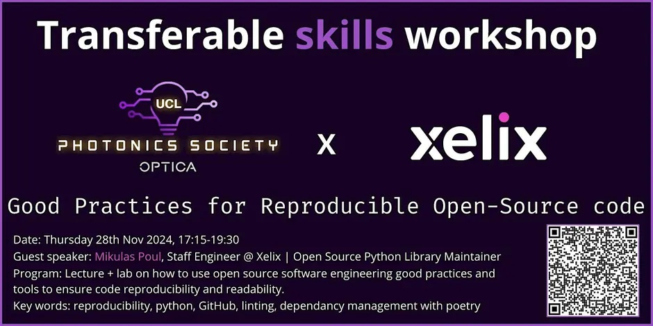

{fig-alt="Good Practices for Reproducible Open Source Code"}

<i class="bi bi-calendar-event"></i> **28 November 2024** · <i class="bi bi-geo-alt"></i> 1-19 Torrington Place

[← All projects & events](../overview.qmd)
