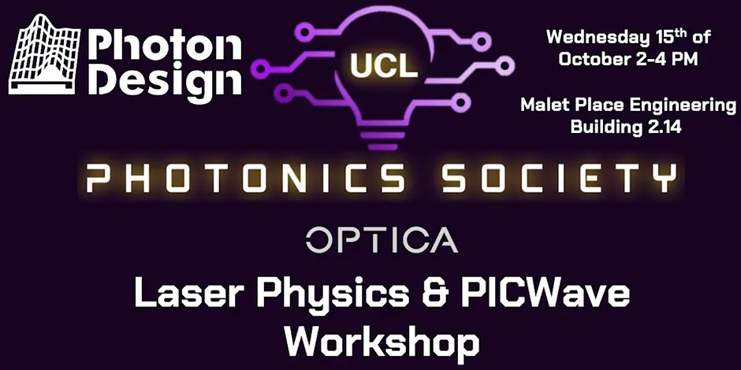

{fig-alt="Laser Physics & PICWave Workshop"}

<i class="bi bi-calendar-event"></i> **15 October 2025** · <i class="bi bi-geo-alt"></i> Malet Place Engineering Building, 2.14

[← All projects & events](../overview.qmd)
