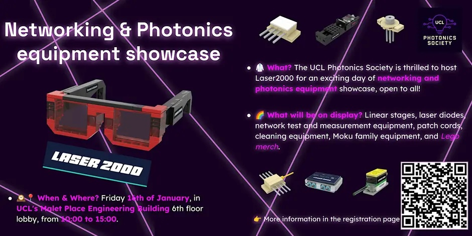

{fig-alt="Laser 2000 — Networking & Photonics equipment showcase"}

<i class="bi bi-calendar-event"></i> **16 January 2026** · <i class="bi bi-geo-alt"></i> Malet Place Engineering Building, 6th floor lobby

[← All projects & events](../overview.qmd)
