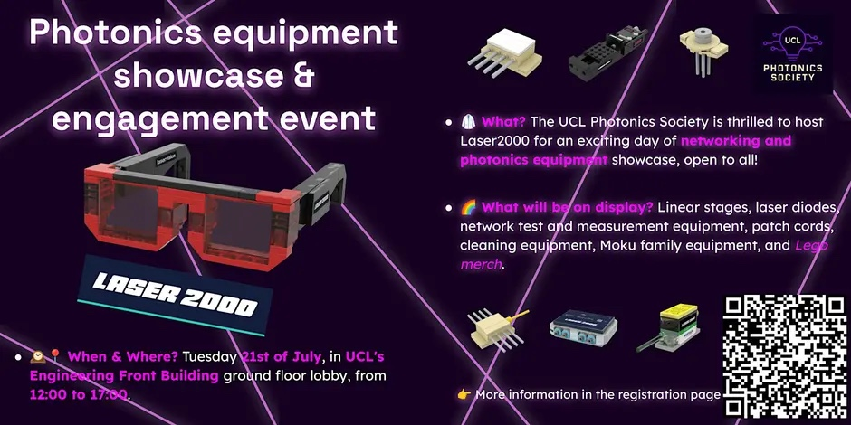

{fig-alt="Laser 2000 — Photonics solutions showcase"}

<i class="bi bi-calendar-event"></i> **21 July 2026** · <i class="bi bi-geo-alt"></i> UCL Engineering Front Building, Foyer G02

[← All projects & events](../overview.qmd)
