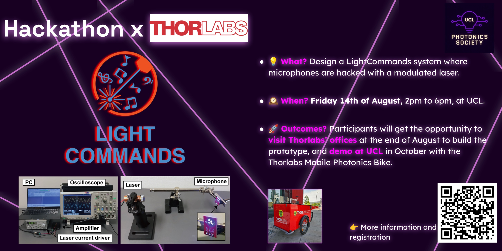

{fig-alt="UCLightCommands Hackathon × Thorlabs"}

<i class="bi bi-calendar-event"></i> **14 August 2026** · <i class="bi bi-geo-alt"></i> University College London

[← All projects & events](../overview.qmd)
