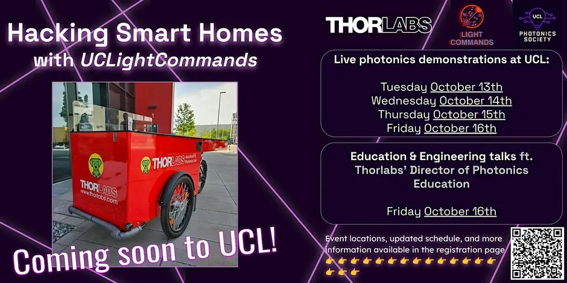

{fig-alt="Hacking Smart Homes with UCLightCommands × Thorlabs"}

<i class="bi bi-calendar-event"></i> **13 – 16 October 2026** · <i class="bi bi-geo-alt"></i> Across UCL campus

[← All projects & events](../overview.qmd)
